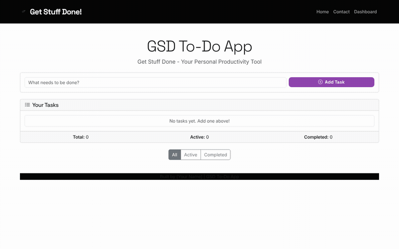
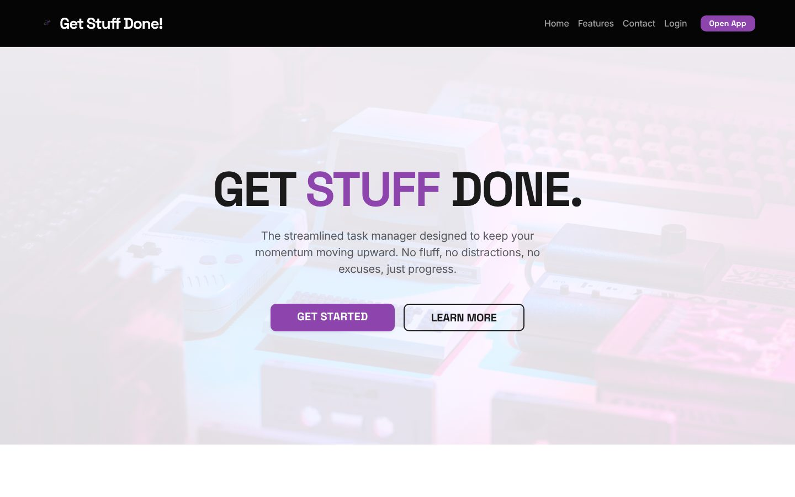
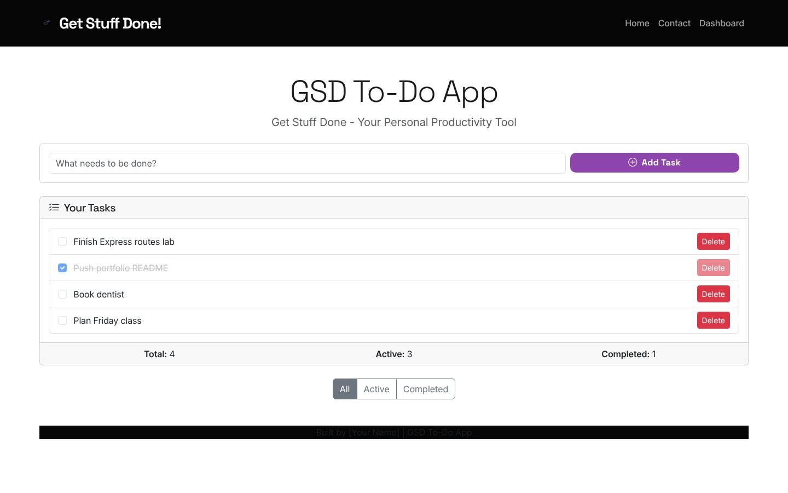
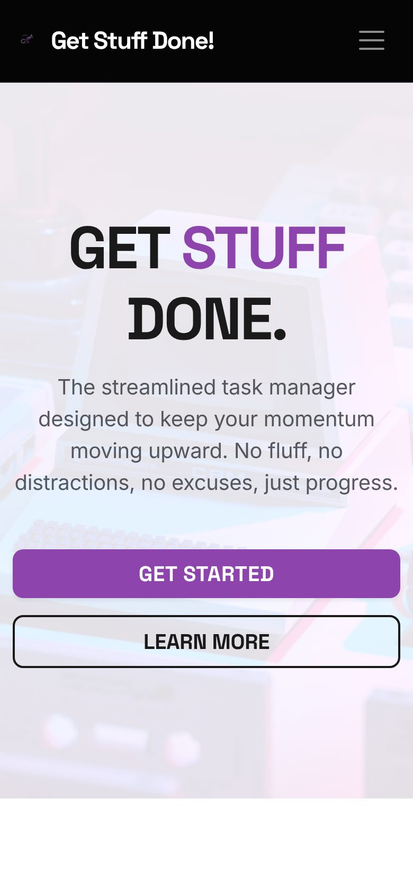

# GSD App — Get Stuff Done

> A beginner-friendly to-do app for learning web development: landing page, a working to-do dashboard with localStorage, demo login/sign-up/contact pages and an Express starter API.

**Live demo:** [get-stuff-done-app-gamma.vercel.app](https://get-stuff-done-app-gamma.vercel.app)

    

## Features

- To-do dashboard: add tasks (button or Enter), tick off, delete, filter All / Active / Completed, live totals
- Tasks persist in the browser with localStorage
- Landing page plus demo login, sign-up and contact pages
- `backend/` Express server with a CRUD `/todos` API for the next lesson
- Every file heavily commented for students

## Tech stack

- HTML5, Bootstrap 5, vanilla JavaScript
- Node.js + Express (backend starter)
- Vercel static hosting with clean URLs

## Run it locally

```bash
git clone https://github.com/thedalycreative/get-stuff-done-app.git
cd get-stuff-done-app
npx serve .            # front end → http://localhost:3000

# optional: the Express API
cd backend && npm install && node script.js   # → http://localhost:3000/todos
```

## Deployment (Vercel)

Static site — no build step (`vercel.json` sets the repo root as output and turns on clean URLs; `backend/` is not deployed). The Vercel project **get-stuff-done-app** deploys `main` to production at **https://get-stuff-done-app-gamma.vercel.app** — the plain `get-stuff-done-app.vercel.app` address is owned by another Vercel account.

## Screenshots



<p align="center">
  
  
  
</p>

_Captured from the live site (https://get-stuff-done-app-gamma.vercel.app). Regenerate with any headless browser; files live in `docs/screenshots/`._

---

A beginner-friendly to-do app project for learning **backend web development**. You already know HTML, CSS, Bootstrap, and basic JavaScript - now it's time to level up!

---

## What Is This Project?

GSD is a task management app with:

- **A landing page** (`index.html`) - the marketing homepage
- **A to-do dashboard** (`dashboard.html`) - the actual app where you add/complete/delete tasks
- **Login & Sign Up pages** (`login.html`, `signup.html`) - forms that will connect to a server later
- **A contact page** (`support.html`) - a contact form that will connect to a server later
- **A backend server** (`backend/script.js`) - an Express.js API we'll connect in a future lesson

---

## Project Structure

```
GSD-APP/
├── index.html          ← Landing page (homepage)
├── dashboard.html      ← To-do app (the main app!)
├── login.html          ← Login form (demo mode - not connected to server yet)
├── signup.html         ← Sign up form (demo mode - not connected to server yet)
├── support.html        ← Contact form (demo mode - not connected to server yet)
├── script.js           ← JavaScript for the dashboard (ADD, DELETE, COMPLETE tasks)
├── style.css           ← Custom styles for the whole app
├── images/             ← Logo and icon files
│   ├── GSD-logo.png
│   ├── GSD-logo.jpg
│   └── GSD-icon.png
├── backend/            ← Server code (we'll use this later!)
│   ├── script.js       ← Express.js server with CRUD API
│   ├── package.json    ← Lists the server's dependencies
│   └── node_modules/   ← Installed packages (auto-generated)
└── README.md           ← You are here!
```

---

## Getting Started (Step by Step)

### Step 1: Open the Project

1. Open **VS Code**
2. Go to `File` → `Open Folder`
3. Select the `GSD-APP` folder
4. You should see all the files in the sidebar

### Step 2: View the App

1. Right-click on `index.html` in VS Code
2. Select **"Open with Live Server"** (if you have the Live Server extension)
3. OR just double-click `index.html` to open it in your browser
4. Click **"GET STARTED"** to go to the dashboard
5. Try clicking around - the login and contact forms show "Demo Mode" messages

> **Tip:** Install the [Live Server extension](https://marketplace.visualstudio.com/items?itemName=ritwickdey.LiveServer) for VS Code. It auto-refreshes your browser when you save changes!

### Step 3: Make the Dashboard Work

> **Note:** in this repo the lines below are already uncommented, so the live demo works. In the student starter, they begin commented out — this step walks through switching them on.

In the student starter, the to-do app dashboard doesn't work yet because some code is **commented out**. Here's how to activate it:

1. Open `script.js` in VS Code
2. Find **Step 3: Event Listeners** (around line 80)
3. **Uncomment** these lines by removing the `//` at the start:

```javascript
// BEFORE (commented out - doesn't work):
// addTaskBtn.addEventListener('click', addTask);

// AFTER (uncommented - now it works!):
addTaskBtn.addEventListener('click', addTask);
```

4. Also uncomment the **Enter key** listener and the **filter button** listeners
5. Find **Step 7: Initialize** (near the bottom) and uncomment those lines too
6. Save the file and refresh your browser
7. Try adding a task, completing it, and deleting it!

### Step 4: Run the Backend Server (Preview for Later)

The backend server is ready but the frontend doesn't use it yet. You can still run it to see how it works:

1. Open your **terminal** in VS Code (`Ctrl + ~` or `Cmd + ~`)
2. Navigate to the backend folder:
   ```
   cd backend
   ```
3. Install the dependencies:
   ```
   npm install
   ```
4. Start the server:
   ```
   node script.js
   ```
5. Open your browser to: **http://localhost:3000/todos**
6. You should see JSON data with sample todos!

> **Note:** The dashboard currently saves tasks in your browser using `localStorage`. In a future lesson, we'll connect it to this backend server so tasks are stored on the server instead.

---

## How the App Works

### The Dashboard (Local - No Server Needed)

The to-do app runs entirely in your browser:

1. You type a task and click "Add Task"
2. JavaScript adds the task to an **array** (a list stored in memory)
3. JavaScript creates HTML elements and adds them to the page
4. Tasks are saved to **localStorage** so they survive page refreshes
5. You can filter, complete, and delete tasks

### Login / Sign Up / Contact (Server Pages - Coming Later!)

These pages have forms, but they **don't actually send data anywhere yet**. They just show alert messages. In a future lesson, we'll:

1. Use `fetch()` to send form data to the backend server
2. Add real user authentication (login/signup)
3. Store contact messages in a database

---

## Your Tasks (Exercises)

### Exercise 1: Activate the To-Do App
- [ ] Uncomment the event listeners in `script.js` (Step 3)
- [ ] Uncomment the DOMContentLoaded listener in `script.js` (Step 7)
- [ ] Test: Add a task, complete it, delete it, refresh the page

### Exercise 2: Customize the App
- [ ] Change `[Your Name]` in the dashboard footer to your actual name
- [ ] Change the brand color in `style.css` (look for `--electric-violet`)
- [ ] Try changing the heading font in `style.css` (look for `--heading-font`)

### Exercise 3: Add a "Clear Completed" Button
- [ ] Add a new button in `dashboard.html` (below the filter buttons)
- [ ] Write a function in `script.js` that removes all completed tasks
- [ ] Hint: Use `.filter()` to keep only tasks where `completed` is `false`

### Exercise 4: Explore the Backend
- [ ] Start the server (`cd backend && node script.js`)
- [ ] Visit `http://localhost:3000/todos` in your browser
- [ ] Use your browser's **Network tab** (DevTools → Network) to watch requests
- [ ] Try using [Postman](https://www.postman.com/) or `curl` to test the API:
  ```
  curl http://localhost:3000/todos
  ```

### Exercise 5: Read the Code Comments
- [ ] Read through every comment in `script.js` - understand each function
- [ ] Read through `style.css` - understand each CSS section
- [ ] Read through `backend/script.js` - understand each route

---

## Bonus Challenges

Once you've completed the exercises above, try these:

1. **Edit Button** - Let users change the text of existing tasks
2. **Task Categories** - Add tags like "work", "personal", "school"
3. **Due Dates** - Add a date picker using `<input type="date">`
4. **Search Bar** - Filter tasks by typing in a search box
5. **Dark Mode** - Add a toggle button to switch between light and dark themes
6. **Animations** - Add fade effects when tasks are added or removed
7. **Task Counter Badge** - Show the count in the browser tab title

---

## Learning Resources

### HTML & CSS

| Topic | Link |
|-------|------|
| HTML Basics | [W3Schools - HTML Tutorial](https://www.w3schools.com/html/) |
| HTML Forms | [MDN - HTML Forms Guide](https://developer.mozilla.org/en-US/docs/Learn/Forms) |
| CSS Basics | [W3Schools - CSS Tutorial](https://www.w3schools.com/css/) |
| CSS Flexbox | [W3Schools - Flexbox](https://www.w3schools.com/css/css3_flexbox.asp) |
| CSS Grid | [W3Schools - Grid](https://www.w3schools.com/css/css_grid.asp) |
| Responsive Design | [MDN - Responsive Design](https://developer.mozilla.org/en-US/docs/Learn/CSS/CSS_layout/Responsive_Design) |
| Bootstrap 5 Docs | [Bootstrap - Getting Started](https://getbootstrap.com/docs/5.3/getting-started/introduction/) |
| Bootstrap Forms | [Bootstrap - Forms](https://getbootstrap.com/docs/5.3/forms/overview/) |
| Bootstrap Grid | [Bootstrap - Grid System](https://getbootstrap.com/docs/5.3/layout/grid/) |

### JavaScript

| Topic | Link |
|-------|------|
| JS Basics | [W3Schools - JavaScript Tutorial](https://www.w3schools.com/js/) |
| DOM Manipulation | [MDN - Introduction to the DOM](https://developer.mozilla.org/en-US/docs/Web/API/Document_Object_Model/Introduction) |
| getElementById | [W3Schools - getElementById](https://www.w3schools.com/jsref/met_document_getelementbyid.asp) |
| addEventListener | [MDN - addEventListener](https://developer.mozilla.org/en-US/docs/Web/API/EventTarget/addEventListener) |
| Array Methods (.push, .filter, .find, .forEach) | [W3Schools - Array Methods](https://www.w3schools.com/js/js_array_methods.asp) |
| localStorage | [MDN - localStorage](https://developer.mozilla.org/en-US/docs/Web/API/Window/localStorage) |
| JSON.stringify / JSON.parse | [W3Schools - JSON](https://www.w3schools.com/js/js_json_stringify.asp) |
| Template Literals (backticks) | [MDN - Template Literals](https://developer.mozilla.org/en-US/docs/Web/JavaScript/Reference/Template_literals) |
| preventDefault | [MDN - preventDefault](https://developer.mozilla.org/en-US/docs/Web/API/Event/preventDefault) |
| Fetch API (for later!) | [MDN - Using Fetch](https://developer.mozilla.org/en-US/docs/Web/API/Fetch_API/Using_Fetch) |

### Backend / Node.js (Preview - We'll Cover This Later)

| Topic | Link |
|-------|------|
| What is Node.js? | [W3Schools - Node.js Intro](https://www.w3schools.com/nodejs/nodejs_intro.asp) |
| What is npm? | [W3Schools - Node.js NPM](https://www.w3schools.com/nodejs/nodejs_npm.asp) |
| Express.js Getting Started | [Express - Hello World](https://expressjs.com/en/starter/hello-world.html) |
| What is an API? | [MDN - Introduction to Web APIs](https://developer.mozilla.org/en-US/docs/Learn/JavaScript/Client-side_web_APIs/Introduction) |
| HTTP Methods (GET, POST, etc.) | [MDN - HTTP Methods](https://developer.mozilla.org/en-US/docs/Web/HTTP/Methods) |
| What is REST? | [MDN - REST](https://developer.mozilla.org/en-US/docs/Glossary/REST) |
| What is CRUD? | [FreeCodeCamp - CRUD Explained](https://www.freecodecamp.org/news/crud-operations-explained/) |

### Dev Tools

| Tool | Link |
|------|------|
| VS Code | [Download VS Code](https://code.visualstudio.com/) |
| Live Server Extension | [VS Code Marketplace](https://marketplace.visualstudio.com/items?itemName=ritwickdey.LiveServer) |
| Chrome DevTools | [Chrome DevTools Docs](https://developer.chrome.com/docs/devtools/) |
| Postman (API Testing) | [Download Postman](https://www.postman.com/downloads/) |

---

## Practice Quizzes & Exercises

Test your knowledge with these free online quizzes and exercises:

### HTML & CSS Quizzes
- [W3Schools HTML Quiz](https://www.w3schools.com/html/html_quiz.asp)
- [W3Schools CSS Quiz](https://www.w3schools.com/css/css_quiz.asp)
- [W3Schools Bootstrap Quiz](https://www.w3schools.com/bootstrap5/bootstrap_quiz.php)

### JavaScript Quizzes
- [W3Schools JavaScript Quiz](https://www.w3schools.com/js/js_quiz.asp)
- [W3Schools JSON Quiz](https://www.w3schools.com/js/js_json_quiz.asp)

### JavaScript Exercises (Practice Coding!)
- [W3Schools JS Exercises](https://www.w3schools.com/js/js_exercises.asp)
- [W3Schools HTML Exercises](https://www.w3schools.com/html/html_exercises.asp)
- [W3Schools CSS Exercises](https://www.w3schools.com/css/css_exercises.asp)
- [FreeCodeCamp - JavaScript Algorithms](https://www.freecodecamp.org/learn/javascript-algorithms-and-data-structures/)

### Interactive Learning
- [FreeCodeCamp - Responsive Web Design](https://www.freecodecamp.org/learn/2022/responsive-web-design/)
- [FreeCodeCamp - JavaScript Course](https://www.freecodecamp.org/learn/javascript-algorithms-and-data-structures-v8/)
- [Codecademy - JavaScript (Free Tier)](https://www.codecademy.com/learn/introduction-to-javascript)
- [The Odin Project - Foundations](https://www.theodinproject.com/paths/foundations)

---

## Key Concepts to Understand

### What is localStorage?
localStorage is a way to save data in the browser. It stores key-value pairs as strings. Data stays even after you close the browser. We use `JSON.stringify()` to save arrays/objects and `JSON.parse()` to read them back.

### What is an Event Listener?
An event listener waits for something to happen (like a click or key press) and then runs a function. Syntax: `element.addEventListener('click', myFunction)`

### What is CRUD?
CRUD stands for **C**reate, **R**ead, **U**pdate, **D**elete - the four basic operations for managing data. Our to-do app does all four!

### What is an API?
An API (Application Programming Interface) is a way for programs to talk to each other. Our Express server creates a REST API that accepts HTTP requests and sends back JSON data.

### What Does "Demo Mode" Mean?
The login, sign up, and contact forms show "Demo Mode" because they aren't connected to a backend server yet. The forms work (they capture input and handle submissions), but they don't actually send data anywhere. We'll connect them to the Express server in a future lesson using `fetch()`.

---

## FAQ

**Q: Why don't the login/signup forms actually work?**
A: They're in "demo mode" - the forms handle submissions with JavaScript but don't send data to a server yet. We'll add that in a future lesson when we learn about `fetch()` and connecting frontend to backend.

**Q: Where are my tasks saved?**
A: In your browser's `localStorage`. Open Chrome DevTools (`F12`) → Application tab → Local Storage to see them!

**Q: What if I break something?**
A: Don't worry! You can always undo changes in VS Code with `Ctrl + Z` (or `Cmd + Z` on Mac). If things get really messed up, you can re-download the starter files.

**Q: Do I need to run the backend server?**
A: Not yet! The to-do dashboard works entirely in the browser. The backend server is there for a future lesson. You can run it to explore, but it's not required.

**Q: What is the `node_modules` folder?**
A: It contains packages (code libraries) that other people wrote. It's created when you run `npm install`. You never need to edit anything in it.

---

## Tech Stack

| Technology | What It Does | Where It's Used |
|-----------|-------------|----------------|
| HTML5 | Page structure | All `.html` files |
| CSS3 | Styling | `style.css` |
| Bootstrap 5 | Layout & components | All pages |
| JavaScript | Makes things interactive | `script.js`, inline `<script>` tags |
| Node.js | Runs JavaScript on a server | `backend/script.js` |
| Express.js | Web server framework | `backend/script.js` |
| localStorage | Saves data in the browser | `script.js` |

---

Built in Perth. &copy; 2026 GSD App.

---

Built by [The Daly Creative](https://www.thedalycreative.com) · Perth, WA
